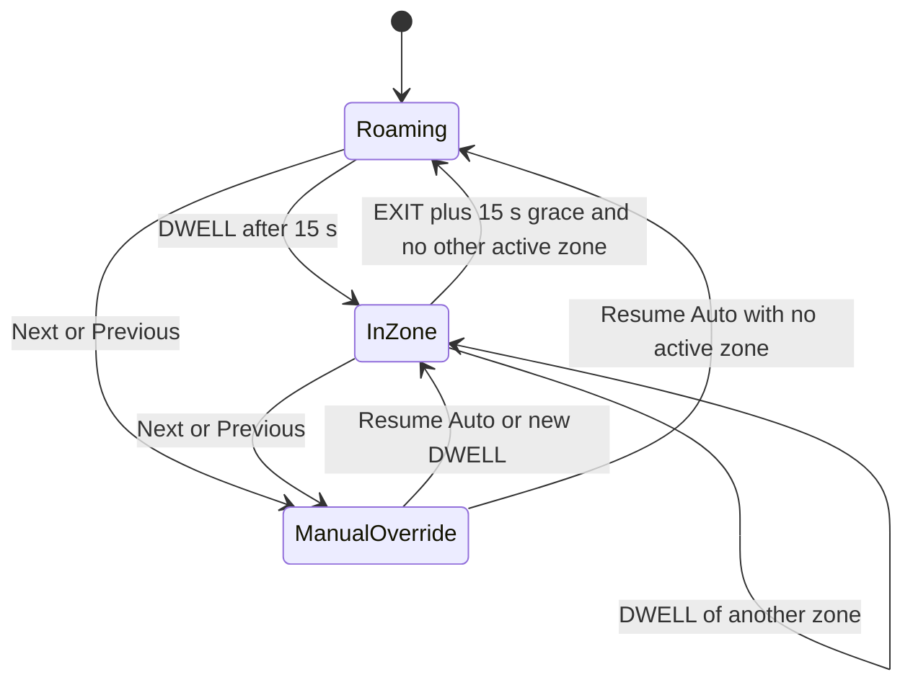

# Specification v2: Persona Context-Aware BGM Mobile Application

| | |
| :--- | :--- |
| **Version** | 2.0 (supersedes `PERSONA_BGM_APP_SPEC.md` v1) |
| **Status** | Ready for implementation |
| **Last updated** | 2026-10-27 |
| **Platform** | Native Android (Kotlin, Jetpack Compose) |

**How to read this document.** Everything from v1 is kept. Where v1 was wrong, incomplete, or technically unworkable, the section has been rewritten and marked with a blockquote:

> **Changed from v1:** explains what was fixed and why.

> **Added in v2:** marks something v1 did not cover at all.

---

## 0. Changelog: v1 to v2

| # | v1 Issue | v2 Resolution | Section |
| :-- | :--- | :--- | :--- |
| 1 | Priority cascade (Weather > Time > Zone > Fallback) could never reach Zone or Fallback, because time-of-day is always Day or Night and would always win | Two-stage resolution: pick the **base track** (zone track or theme default), then pick the best **weather/time variant** of it | 5.3 |
| 2 | Manifest `stream_url` values for two tracks were wrapped in markdown link syntax and would fail in ExoPlayer/Retrofit | Plain URLs; manifest schema v2 adds `theme_defaults`, `variant_group`, optional `size_bytes`; client-side validation | 7.1 |
| 3 | Two ExoPlayers feeding one `MediaSession` was unspecified, and two focus-handling players fight each other | `CrossfadePlayer` facade bound to the session; a **single** `AudioFocusController` owns audio focus; both players run with `handleAudioFocus = false` | 4.1, 4.3 |
| 4 | Manual handling of noisy-audio and focus events | Use Media3 built-ins where they work (`handleAudioBecomingNoisy`); custom focus controller only because of the dual-player design; 20% duck retained | 4.3 |
| 5 | "0 latency" from `SimpleCache` is false, since the cache only holds what has already been played | Proactive pre-caching via `CacheWriter` + WorkManager; stable cache keys; cache stored in `filesDir`; cache health check | 4.4 |
| 6 | Custom 15 s debounce | Native `GEOFENCE_TRANSITION_DWELL` with 15,000 ms loitering delay; symmetric 15 s exit grace in the context engine | 5.1, 5.6 |
| 7 | Default geofence radius 75 m is below the platform's recommended minimum | Default **150 m**, minimum **100 m**, per-zone adjustable | 5.1 |
| 8 | Geofences are lost on reboot and other events; no recovery plan | Boot receiver, re-registration triggers, periodic health check; Android 15 boot-receiver FGS restriction respected | 5.2 |
| 9 | Onboarding missed `POST_NOTIFICATIONS`, treated Bluetooth as mandatory, and ignored Android 11+ background-location flow | Reordered onboarding; background location is its own step with a Settings deep-link; Bluetooth optional; permission health check | 3.2 |
| 10 | Permission list incomplete; no service declaration | Added `RECEIVE_BOOT_COMPLETED`, `ACCESS_NETWORK_STATE`, conditional `FOREGROUND_SERVICE_LOCATION`, legacy Bluetooth permission, full service/receiver XML | 6 |
| 11 | Weather behavior undefined beyond "Rain" | WMO code mapping, polling cadence, staleness rules, offline fallback | 5.4 |
| 12 | "Next" key event had no defined meaning in a context-driven app | `Next`/`Previous` enter a **Manual Override** mode; "Resume Auto" returns to the resolver | 4.5, 5.6 |
| 13 | Crossfade was linear only (audible loudness dip at midpoint) | Equal-power curve is the default; linear remains selectable; 2500 ms duration kept | 4.2 |
| 14 | Spec had no offline manifest handling, screen list, error matrix, test plan, or licensing note | All added | 3.3, 7, 8, 9, 10 |
| 15 | Battery-optimization exemption has Google Play policy implications | Documented, with fallback intent and OEM guidance | 5.7 |

---

## 1. Project Overview

A native Android application inspired by the *Persona* video game series (P3 Reload, P4 Revival, P5 Royal). The app streams location-aware background music (BGM) while running in the background. It dynamically changes tracks based on GPS Geofence regions, Time of Day, Weather, and active Game Theme, while managing crossfading, offline caching, and hardware audio routing.

### 1.1 Goals

- Seamless, context-aware BGM that keeps playing with the screen off.
- Three switchable visual themes matching Persona 3 Reload, Persona 4 Revival, and Persona 5 Royal.
- Works offline for any track that has been cached.
- Survives reboot, process death, and aggressive OEM battery managers as far as the platform allows.

### 1.2 Non-Goals (v2)

- iOS, Wear OS, or desktop clients.
- Android Auto browse UI (media key events from car hardware **are** in scope).
- Server-side accounts or cloud sync.
- Continuous high-frequency GPS tracking (geofencing is the primary trigger).

### 1.3 Content & Licensing

> **Added in v2:** The Persona soundtrack and branding belong to Atlus/Sega. See section 10 before distributing anything publicly. All `cdn.example.com` URLs in this document are placeholders.

---

## 2. Tech Stack & Architecture

- **Language**: Kotlin 2.0+ (K2 compiler)
- **UI Framework**: Jetpack Compose (Single Activity Architecture) with Navigation Compose
- **Audio Engine**: Jetpack Media3 (`ExoPlayer`, `MediaSessionService`, `SimpleCache`, `CacheWriter`)
- **Location & Geofencing**: Google Play Services (`GeofencingClient`, `FusedLocationProviderClient`, `SettingsClient`)
- **Database**: Room Database (Geofence zones, cached manifest, zone state, custom mappings)
- **Preferences**: Jetpack DataStore (Active theme, global volume, settings)
- **Network**: Retrofit + Kotlinx Serialization (Fetching JSON track manifest & Open-Meteo Weather API), OkHttp
- **Dependency Injection**: Hilt
- **Architecture Pattern**: MVVM with Clean Architecture (UI -> ViewModel -> Repository -> Data Source)

> **Added in v2:**
> - **KSP, not kapt**, for Hilt and Room code generation.
> - **WorkManager** for pre-caching tracks and the periodic geofence health check.
> - **Maps Compose** (Google Maps SDK) for the zone map. Requires a Maps API key supplied via `local.properties` / Secrets Gradle Plugin, never committed. (Alternative: MapLibre/OSM if you want to avoid a Google API key. See section 12.)
> - **Version catalog** (`libs.versions.toml`): pin all library versions to the latest stable at project start.
> - Suggested SDK levels: `minSdk 26`, `targetSdk`/`compileSdk` = latest stable required by Google Play.

### 2.1 Layering

```
UI (Compose screens, ViewModels)
  -> Domain (models, use cases, ContextResolver)
    -> Data (repositories)
      -> Sources: Room, DataStore, Retrofit (manifest, weather), Play Services (geofencing), Media3 (cache)

Service layer (process-level, outlives the UI):
  PlaybackService (MediaSessionService) hosts players, session, focus controller, and the ContextEngine collector.
  GeofenceReceiver / BootReceiver feed events into Room, then ensure the service is running.
```

### 2.2 Suggested Package Layout

```
com.yourapp.persona/
  di/                 Hilt modules (Network, Database, Cache, Audio, Location)
  data/
    local/            Room (entities, DAOs), DataStore
    remote/           ManifestApi, WeatherApi, DTOs
    repository/       ManifestRepository, ZoneRepository, WeatherRepository, SettingsRepository
  domain/
    model/            Track, Zone, PlaybackContext, WeatherType, TimeBucket, GameTheme
    resolver/         ContextResolver (pure Kotlin, fully unit-tested)
    usecase/
  audio/              PlaybackService, CrossfadeController, CrossfadePlayer,
                      AudioFocusController, MediaCacheProvider, PrecacheWorker
  geofence/           GeofenceManager, GeofenceReceiver, BootReceiver, GeofenceHealthWorker
  context/            ContextEngine, WeatherMapper, TimeBucketClock
  ui/
    theme/            PersonaTheme (P3R, P4R, P5R), shapes, motion
    onboarding/ home/ map/ zones/ library/ settings/ components/
```

---

## 3. Core Features & Design System

### 3.1 Theme Matrix (Dynamic Theme Switcher)
The app must support live theme switching between 3 distinct Persona aesthetics:

| Theme | Primary Color | Accent Color | Surface / Background | Aesthetic Style |
| :--- | :--- | :--- | :--- | :--- |
| **Persona 3 Reload** | Cobalt Blue (`#0055FF`) | Electric Cyan (`#00E5FF`) | Dark Slate (`#0A0E17`) | Sleek liquid cutouts, dark aquatic gradients |
| **Persona 4 Revival** | TV Yellow (`#FFD000`) | Pop Orange (`#FF6600`) | Off-Black (`#181818`) | CRT lines, pop-art badges, halftone dots |
| **Persona 5 Royal** | Crimson Red (`#D80027`) | Pure White (`#FFFFFF`) | Obsidian Black (`#101010`) | Slanted diagonal text, dynamic comic cutouts |

> **Added in v2: Implementation notes**
> - Model each theme as a `PersonaTheme` object holding a Material 3 `darkColorScheme`, extra tokens (accent, halftone/CRT overlay config, corner-cut shapes), and typography.
> - Provide the active theme via a `CompositionLocal`. Animate color changes with `animateColorAsState` so switching is a live transition, not a restart.
> - Persist the selection in DataStore. The active theme also selects the **roaming default track** (section 5.3).
> - **Contrast:** Cobalt Blue on Dark Slate is roughly 3.4:1, which passes for large text and graphics but not for small body text. Use the Accent (Cyan) for small text on the P3 theme and reserve the Primary for fills, large headings, and icons.
> - **Reduce motion:** CRT scanlines, halftone animation, and shimmer must respect the system "Remove animations" setting and an in-app toggle.

### 3.2 Quality of Life (QoL) & Loading States

#### Smooth Onboarding
A step-by-step stylized setup flow for required permissions.

> **Changed from v1:** v1 order was Location -> Background Location -> Battery Optimization -> Bluetooth. v2 adds Notifications, makes Bluetooth optional, and spells out the Android 11+ background-location behavior.

| Step | Screen | Permission / Action | Notes |
| :-- | :--- | :--- | :--- |
| 1 | Welcome + theme pick | None | Lets the person see the app's style immediately; sets the initial theme. |
| 2 | Location (foreground) | `ACCESS_FINE_LOCATION` + `ACCESS_COARSE_LOCATION` | Request both together. If the person grants only **approximate**, show a warning: geofences need precise location to be reliable. |
| 3 | Location (background) | `ACCESS_BACKGROUND_LOCATION` | **Separate step, only after step 2 is granted.** Show a rationale screen first. On Android 11+ the system does not show an "Allow all the time" dialog; it sends the person to the app's location settings page, so the screen must say exactly which option to tap. Re-check the permission on return. |
| 4 | Notifications | `POST_NOTIFICATIONS` (Android 13+) | Without it the playback notification is hidden. Skip silently on older versions. |
| 5 | Battery optimization | `Settings.ACTION_REQUEST_IGNORE_BATTERY_OPTIMIZATIONS` | Needed so OEMs (Samsung/Xiaomi/etc.) do not kill the listener. Includes OEM-specific tips (autostart, "sleeping apps"). See 5.7 for the Play policy caveat. |
| 6 | Bluetooth (**optional**) | `BLUETOOTH_CONNECT` (Android 12+) | Only for showing the connected output device name and similar niceties. Auto-pause on disconnect is expected to work without it (verify on API 31+ devices). The person can skip. |

Completion rules:
- Store `onboarding_completed` in DataStore.
- **Permission Health card** on Home: re-checks all permissions on every `ON_RESUME` and shows a one-tap fix if anything was revoked.
- Android auto-resets permissions for apps that go unused for a long time (Android 11+). The onboarding and Settings screens should offer a shortcut to the system "Pause app activity if unused" toggle (`Intent.ACTION_AUTO_REVOKE_PERMISSIONS`).

#### Loading States (LCE Pattern)
Implement Loading, Content, and Error states for all network/database actions.

```kotlin
sealed interface UiState<out T> {
    data object Loading : UiState<Nothing>
    data class Content<T>(val data: T) : UiState<T>
    data class Error(val cause: AppError, val retry: (() -> Unit)? = null) : UiState<Nothing>
}
```

- *Manifest Fetch*: Show a stylized "Connecting to Metaverse..." (P3/P5) or "Tuning TV..." (P4) animated screen.
- *Map Load*: Use skeleton shimmering matching the current theme's primary color before the map fully renders (hide the skeleton on the map's `onMapLoaded` callback).

> **Added in v2:** The full-screen manifest loading screen is shown **only when there is no cached manifest**. If a cached copy exists, the app opens straight to Content and refreshes in the background (stale-while-revalidate).

#### Haptic Feedback
Implement `HapticFeedbackType.LongPress` and `TextHandleMove` via Compose for sharp, tactile feedback when navigating the UI, switching themes, or dropping a geofence pin.

> **Added in v2: Mapping and rules**
> | Interaction | Haptic |
> | :--- | :--- |
> | Bottom-nav / tab change, list item select | `TextHandleMove` |
> | Theme switch | `LongPress` |
> | Dropping a geofence pin, confirming zone creation | `LongPress` |
>
> Wrap calls in a `HapticsController` that checks an in-app "Haptics" toggle (DataStore). Newer Compose versions offer additional semantic types (for example confirm/reject/toggle); they may be used with a fallback to the two above on older versions.

#### Error Handling & Fallbacks
- *No Internet*: Play from cached ExoPlayer tracks; disable weather overrides (fallback to clear weather logic).
- *GPS Disabled*: Show a high-contrast in-app banner prompting the user to enable Location Services.

> **Added in v2:** See the full error matrix in section 8. For GPS: detect with `LocationManagerCompat.isLocationEnabled`, listen to `LocationManager.PROVIDERS_CHANGED_ACTION`, and have the banner button open `Settings.ACTION_LOCATION_SOURCE_SETTINGS` (or use `SettingsClient.checkLocationSettings` for the in-app resolution dialog).

### 3.3 Screen Inventory

> **Added in v2:** v1 named only onboarding, loading, and the map. Minimum screen set:

| Screen | Purpose |
| :--- | :--- |
| **Onboarding** | Section 3.2 flow |
| **Home / Now Playing** | Current track, resolved context chips (Zone, Weather, Day/Night, Theme), play/pause, Next/Previous, "Resume Auto" when in Manual Override, Permission Health card, GPS banner |
| **Map** | Zones as circles, long-press to drop a pin, current device position |
| **Zone Editor** | Name, radius slider (100 to 500 m), track picker (from manifest), enable/disable, delete |
| **Library** | Manifest tracks grouped by theme, cache status per track (not cached / caching / cached), manual download |
| **Settings** | Theme, global volume, crossfade duration and curve, weather override on/off, "Pre-cache on Wi-Fi only", haptics, reduce motion, clear audio cache, battery/permission shortcuts |
| **Debug panel** (debug builds only) | Live resolved context, active zones, geofence registration status, last weather fetch, cache stats |

---

## 4. Audio Engine & Media3 Integration

### 4.1 Players, Session, and Facade

- **Dual ExoPlayer Instances**: Maintain `ExoPlayerA` and `ExoPlayerB` inside `MediaSessionService`.

> **Changed from v1:** A `MediaSession` binds to exactly one `Player`, and two focus-handling players would fight each other. The service therefore consists of:

| Component | Responsibility |
| :--- | :--- |
| `PlaybackService` | `@AndroidEntryPoint MediaSessionService`. Hosts everything below. Declared with `foregroundServiceType="mediaPlayback"`. |
| `ExoPlayerA` / `ExoPlayerB` | Identical configuration: `AudioAttributes(USAGE_MEDIA, CONTENT_TYPE_MUSIC)`, **`handleAudioFocus = false`**, `setHandleAudioBecomingNoisy(true)`, `setWakeMode(C.WAKE_MODE_NETWORK)`, `repeatMode = REPEAT_MODE_ONE`, shared cache-backed `MediaSourceFactory`. |
| `CrossfadeController` | Owns which player is *active*, runs fades, owns the **master gain** (see 4.2). |
| `AudioFocusController` | The **only** audio-focus owner (see 4.3). |
| `CrossfadePlayer` | A `ForwardingPlayer` wrapped around the *active* ExoPlayer and bound to the `MediaSession`. Overrides `play()`/`pause()` so both players and the resume fade are handled, and `seekToNext()`/`seekToPrevious()` so they trigger Manual Override (4.5). |
| `MediaSession` | Built with `setSessionActivity(...)` so tapping the notification opens the app. |

Swapping roles after a crossfade: call `mediaSession.setPlayer(CrossfadePlayer(newActive))` **once, after the fade completes** (not at its start) so the notification updates a single time. If that causes notification flicker or state glitches in testing, replace the facade with a `SimpleBasePlayer` implementation.

Handle `ForegroundServiceStartNotAllowedException` when starting the service from the background: fall back to a high-priority notification that lets the person tap to resume.

### 4.2 Crossfading & Playback

- **Crossfade Logic**: Upon location/context trigger, perform a crossfade over **2500 ms**.
- **Buffer Fade-In**: Automatically apply a 300ms volume fade-in when playback is manually resumed to prevent audio popping on Bluetooth devices.

> **Changed from v1:** v1 specified a linear fade (A: 1.0 -> 0.0, B: 0.0 -> 1.0). A linear crossfade of two uncorrelated tracks produces a noticeable loudness dip at the midpoint. v2 uses an **equal-power** curve by default; **linear is still available** as a setting.

```kotlin
enum class CrossfadeCurve { EQUAL_POWER, LINEAR }

/** t in [0,1]. Returns (incomingGain, outgoingGain). */
fun crossfadeGains(t: Float, curve: CrossfadeCurve): Pair<Float, Float> = when (curve) {
    CrossfadeCurve.LINEAR      -> t to (1f - t)
    CrossfadeCurve.EQUAL_POWER -> sin(t * (PI / 2)).toFloat() to cos(t * (PI / 2)).toFloat()
}
```

Procedure for `crossfadeTo(track)`:

1. Take the **inactive** player. Set `volume = 0f`, `setMediaItem(item)` (with `setCustomCacheKey(track.id)`), `prepare()`, `playWhenReady = true`.
2. Wait for `STATE_READY`. **Timeout 8 s**: on timeout, abort and keep the current track playing (never create silence); schedule one retry.
3. Animate `t` from 0 to 1 over `crossfadeDurationMs` (default 2500) on a ~16 ms tick, on the player's application thread (usually main). Each tick sets `incoming.volume = inGain * master` and `outgoing.volume = outGain * master`.
4. Stop and clear the outgoing player, swap active/inactive roles, rebind the session (4.1).
5. If a new target arrives mid-fade, remember only the **latest** one and start it after the current fade completes (at most 2.5 s later).

**Master gain** = `userVolume (DataStore) x duckFactor (focus) x resumeRamp (0 to 1 over 300 ms)`. It is re-applied to both players whenever any factor changes, so ducking and manual resume ramps work correctly mid-crossfade.

### 4.3 Hardware Interruptions & Audio Focus

- Handle `ACTION_AUDIO_BECOMING_NOISY` to auto-pause when AUX cables or Bluetooth headphones disconnect.
- Handle `AUDIOFOCUS_GAIN`, `AUDIOFOCUS_LOSS` (pause), and `AUDIOFOCUS_LOSS_TRANSIENT_CAN_DUCK` (lower volume to 20% for notifications).
- Wire `MediaSession` to accept Bluetooth remote/car hardware key events (Play, Pause, Next).

> **Changed from v1:**
> - **Noisy audio:** Media3 already does this. `setHandleAudioBecomingNoisy(true)` on both players. The controller observes `onPlayWhenReadyChanged(false, PLAY_WHEN_READY_CHANGE_REASON_AUDIO_BECOMING_NOISY)` on either player and pauses the pair, cancelling any in-flight fade.
> - **Focus:** built-in focus handling is disabled on both players (otherwise requesting focus for the incoming player would cause the outgoing one to receive `AUDIOFOCUS_LOSS` mid-crossfade). `AudioFocusController` requests focus once (`AudioManagerCompat` / `AudioFocusRequestCompat`, `USAGE_MEDIA`, `CONTENT_TYPE_MUSIC`) when playback starts and holds it across crossfades.

| Focus event | Behavior |
| :--- | :--- |
| `AUDIOFOCUS_GAIN` | Restore `duckFactor = 1.0`. If playback was paused by a transient loss, resume with the 300 ms fade-in. |
| `AUDIOFOCUS_LOSS` | Pause both players, abandon focus. **No auto-resume**; the person must press Play. |
| `AUDIOFOCUS_LOSS_TRANSIENT` | Pause; resume on `GAIN` with the 300 ms fade-in. |
| `AUDIOFOCUS_LOSS_TRANSIENT_CAN_DUCK` | `duckFactor = 0.2` (20%); restore on `GAIN`. |

### 4.4 Offline Caching & Pre-Caching

- **Offline Caching**: Wrap ExoPlayer `DataSource` with Media3 `SimpleCache` (configurable 1 GiB default LRU (256 MiB–2 GiB)) to eliminate repeated network downloads and ensure 0 latency on geofence triggers.

> **Changed from v1:** `SimpleCache` only stores bytes that have **already been played or downloaded**, so a cache alone cannot give "0 latency" on the first trigger. v2 adds explicit pre-caching.

```kotlin
@Provides @Singleton
fun provideCache(@ApplicationContext ctx: Context): SimpleCache =
    SimpleCache(
        File(ctx.filesDir, "media_cache"),          // filesDir, not cacheDir: the OS may purge cacheDir
        LeastRecentlyUsedCacheEvictor(500L * 1024 * 1024),
        StandaloneDatabaseProvider(ctx)
    )

@Provides @Singleton
fun provideCacheDataSourceFactory(cache: SimpleCache, client: OkHttpClient) =
    CacheDataSource.Factory()
        .setCache(cache)
        .setUpstreamDataSourceFactory(OkHttpDataSource.Factory(client))
        .setFlags(CacheDataSource.FLAG_IGNORE_CACHE_ON_ERROR)
```

Rules:
- **One `SimpleCache` instance per directory**, as a Hilt `@Singleton`. Creating two instances for the same folder crashes.
- **Stable cache keys:** use the track `id` as the key (`MediaItem.Builder().setCustomCacheKey(track.id)` for playback, `DataSpec.Builder().setKey(track.id)` for pre-caching) so CDN URL or signed-URL changes do not invalidate cached audio.
- **Pre-cache job** (`PrecacheWorker`, a `CoroutineWorker`) downloads with `CacheWriter(cacheDataSource, dataSpec, null, progressListener).cache()` on `Dispatchers.IO`. Triggers:
  1. A zone is created or its track changes.
  2. First launch / theme change: the theme's default (roaming) group.
  3. Manifest version changes.
- Constraints: network connected; optionally **unmetered only** (Settings toggle, default on).
- **Cache health check** (on app start and after each manifest refresh): for every track assigned to a zone or used as a theme default, compare `cache.getCachedBytes(key, 0, size)` with `size_bytes` (or known content length) and re-queue anything missing. This covers LRU eviction and "Clear storage".
- Capacity note: a typical 3-minute AAC track is a few MB, so 500 MB holds well over a hundred tracks; eviction is unlikely in normal use.
- Settings exposes cache size and a "Clear audio cache" action.

### 4.5 Media Controls & Session Semantics

> **Added in v2:** v1 required Play/Pause/Next key events but never defined what "Next" means when music is chosen by context.

- **Play / Pause**: toggles both players with the 300 ms resume fade-in.
- **Next / Previous**: enter **Manual Override**. Next picks the next track from the **active theme's** pool (manifest order, wrapping); Previous walks back through an in-memory override history. While in Manual Override, the resolver output is **ignored** and the notification/Home shows a "Resume Auto" action.
- **Resume Auto**: leaves Manual Override and crossfades to whatever the resolver currently says.
- Manual Override also ends automatically on a **new zone DWELL** (a context change the person did not ask for should be honored).
- Publish `MediaMetadata` (title, artist, theme-colored placeholder artwork, plus the current zone name as `subtitle`) for the notification and Bluetooth/car displays.

### 4.6 Looping

> **Added in v2:** BGM tracks loop with `REPEAT_MODE_ONE`. AAC/M4A can leave a tiny gap at the loop point depending on encoder padding metadata. Test loop points early; if a gap is audible, encode loops as Opus/OGG or ensure the files carry gapless metadata.

---

## 5. Geofencing & Context Manager

### 5.1 Geofence Parameters

- **Dwell**: Use the built-in **`GEOFENCE_TRANSITION_DWELL` with a 15,000 ms loitering delay** before track switching.
- **Radius**: **Default 150 m, minimum 100 m**, adjustable per zone (UI slider 100 to 500 m).
- **Limit**: Android allows **100 geofences per app per device user**. The UI blocks creating a 101st zone with a clear message.

> **Changed from v1:**
> - v1 asked for a custom "15 second hysteresis debounce". The Geofencing API already provides this as DWELL + loitering delay; building a second debounce on top is redundant.
> - v1's default radius of 75 m is below the platform's recommended minimum (roughly 100 to 150 m), because geofence accuracy depends on Wi-Fi/cell data and 75 m triggers are unreliable.

```kotlin
val geofence = Geofence.Builder()
    .setRequestId(zone.id)
    .setCircularRegion(zone.lat, zone.lng, zone.radiusM)
    .setExpirationDuration(Geofence.NEVER_EXPIRE)
    .setTransitionTypes(
        Geofence.GEOFENCE_TRANSITION_ENTER or      // UI hint only ("Entering ...")
        Geofence.GEOFENCE_TRANSITION_DWELL or      // triggers track switching
        Geofence.GEOFENCE_TRANSITION_EXIT)
    .setLoiteringDelay(15_000)
    .build()

val request = GeofencingRequest.Builder()
    .setInitialTrigger(GeofencingRequest.INITIAL_TRIGGER_DWELL)   // fires if already inside on registration
    .addGeofences(geofences)
    .build()

val flags = PendingIntent.FLAG_UPDATE_CURRENT or
    (if (Build.VERSION.SDK_INT >= Build.VERSION_CODES.S) PendingIntent.FLAG_MUTABLE else 0)  // geofencing needs a mutable PI
val pendingIntent = PendingIntent.getBroadcast(
    ctx, 0, Intent(ctx, GeofenceReceiver::class.java), flags)
```

### 5.2 Lifecycle, Persistence & Receivers

> **Added in v2:** Geofences are **not** permanent. Re-register them (idempotent: same `requestId` replaces) when:
> - the device **reboots** (`BOOT_COMPLETED`),
> - the app is updated (`MY_PACKAGE_REPLACED`, defensive),
> - the app data or Google Play services data is cleared,
> - a geofence event reports `GEOFENCE_NOT_AVAILABLE`, or location mode changes (location turned off/on),
> - the periodic **`GeofenceHealthWorker`** (WorkManager, about every 12 hours) runs.

Receiver rules:
- **`GeofenceReceiver`** (`exported="false"`): parse with `GeofencingEvent.fromIntent`, handle `hasError()` (log; on `GEOFENCE_NOT_AVAILABLE` trigger re-registration), **persist the transition to Room first** (so no event is lost if the process dies), then ensure `PlaybackService` is running. Do not run long work or the 15 s grace timer inside the receiver; the service's coroutine scope does that.
- **`BootReceiver`**: re-register geofences **only**. **Do not start the media foreground service from `BOOT_COMPLETED`.** Android 15 blocks boot receivers from launching `mediaPlayback` foreground services. Playback resumes when the next geofence event arrives or the person opens the app.
- Starting the service from a geofence event: Android's background-start restrictions list geofence transition events as an exemption, which is what makes this design viable. Verify this against the current docs for the target API level.
- Real-world geofence triggers commonly lag by a minute or more, sometimes longer. The UX must never imply instant response (see the optional fast-path below).

> **Optional enhancement (Phase 6):** while the app is **in the foreground**, supplement geofencing with `FusedLocationProviderClient` balanced-power updates and compute distance to zone centers locally, so entering a zone while looking at the app feels immediate. Stop updates when the app leaves the foreground.

`FOREGROUND_SERVICE_LOCATION` and a `location` foreground-service type are **not** needed for the baseline design, because geofencing runs inside Google Play services and the service only plays audio. Add them only if continuous location updates are later run from the service.

### 5.3 Context Resolution

> **Changed from v1:** v1's Context Priority Cascade (1. Weather Override, 2. Time-of-Day Override, 3. Location Geofence Track, 4. Fallback) cannot work as written. Time-of-day is always either Day or Night, so rule 2 always matches and rules 3 and 4 could never play. Weather and time-of-day are now **variant selectors applied to a base track**, not competing tiers.

**Stage 1: Choose the base track**
1. If the person is **inside a zone** and that zone has an assigned track: base = the zone's track.
2. Otherwise (roaming, or zone with no assignment): base = the **active theme's default track** (`theme_defaults` in the manifest).

**Stage 2: Choose the best variant of the base track**
- Candidates = all manifest tracks sharing the base track's `variant_group` (a track with no group is a group of one).
- A candidate is **eligible** if `weather in {ALL, currentWeather}` **and** `timeOfDay in {ALL, currentTime}`.
- Score: `+2` if the candidate's weather equals the current weather exactly, `+1` if its time-of-day equals the current time exactly. Weather therefore outranks time-of-day, which preserves v1's intent that rain is the stronger signal.
- Pick the highest score; ties go to the base track, then to the lowest `id` (deterministic).
- If **no candidate is eligible, play the base track**. Never leave a zone silent.

```kotlin
enum class TimeBucket { DAY, NIGHT }
enum class WeatherType { CLEAR, RAIN, SNOW }               // runtime values
enum class TrackTime { ALL, DAY, NIGHT }                   // manifest values
enum class TrackWeather { ALL, CLEAR, RAIN, SNOW }         // manifest values

data class PlaybackContext(
    val activeZone: Zone?,
    val theme: GameTheme,
    val weather: WeatherType,
    val time: TimeBucket,
)

fun resolve(ctx: PlaybackContext, manifest: Manifest): Track? {
    val base = ctx.activeZone?.assignedTrackId?.let(manifest::trackById)
        ?: manifest.themeDefault(ctx.theme)
        ?: return null

    val group = base.variantGroup
        ?.let { g -> manifest.tracks.filter { it.variantGroup == g } }
        ?: listOf(base)

    fun score(t: Track) =
        (if (t.weather.matchesExactly(ctx.weather)) 2 else 0) +
        (if (t.timeOfDay.matchesExactly(ctx.time)) 1 else 0)

    return group
        .filter { it.weather.accepts(ctx.weather) && it.timeOfDay.accepts(ctx.time) }
        .maxWithOrNull(compareBy<Track>({ score(it) }, { it.id == base.id }).thenByDescending { it.id })
        ?: base
}
```

`resolve` is a **pure function** and must have exhaustive unit tests (section 9).

**Overlapping zones:** keep the set of currently active zones (each with the time of its DWELL). The most recent DWELL wins. When it EXITs, fall back to another still-active zone if one exists, otherwise to roaming.

### 5.4 Weather

> **Added in v2:** v1 only said "Open-Meteo returns Rain". Concrete rules:

- **Request:** `GET https://api.open-meteo.com/v1/forecast?latitude={lat}&longitude={lon}&current=weather_code&timezone=auto`
- **Location used:** the active zone's center when inside a zone; otherwise the device's last known location. **Round coordinates to 2 decimals** (about 1 km) before sending, for privacy and better caching.
- **Cadence:** refresh at most every 20 minutes while playing, and when the device has moved more than about 5 km since the last fetch. Cache the last result with a timestamp.
- **Staleness:** a result older than 3 hours is ignored (treated as CLEAR).
- **Offline / error:** no network, HTTP error, or parse failure -> `WeatherType.CLEAR` and weather overrides are effectively disabled (matches the v1 fallback rule).
- **Terms:** Open-Meteo's free API is for non-commercial use. Check its current terms before any commercial release.

| WMO weather code(s) | Runtime `WeatherType` |
| :--- | :--- |
| 0, 1, 2, 3, 45, 48 (clear, clouds, fog) | `CLEAR` |
| 51-57 (drizzle), 61-67 (rain), 80-82 (rain showers), 95-99 (thunderstorm) | `RAIN` |
| 71-77 (snow), 85-86 (snow showers) | `SNOW` |
| Anything else / unknown | `CLEAR` |

### 5.5 Time of Day

- **Day**: 06:00 to 18:00 local device time. **Night**: 18:00 to 06:00.
- `TimeBucketClock` emits a `Flow<TimeBucket>`: computes the next boundary and `delay`s until then, and re-computes on `ACTION_TIME_CHANGED`, `ACTION_TIMEZONE_CHANGED`, and `ACTION_DATE_CHANGED`. No exact alarms are needed because the clock only matters while the service is alive.
- Future option: use sunrise/sunset from Open-Meteo instead of fixed hours.

### 5.6 Context Engine & State Machine

`ContextEngine` (runs in the `PlaybackService` coroutine scope) combines: active zones (from Room), weather, time bucket, active theme (DataStore), and the manifest. Its output is a `Flow<Track?>` with:
- `distinctUntilChanged()` so identical results never trigger a crossfade,
- a **1 s debounce** to coalesce near-simultaneous changes (for example a zone change plus a weather refresh),
- suppression while in **Manual Override**.

**Exit grace:** an `EXIT` transition is applied after a **15 s grace window**, cancelled if the same zone reports a new transition in that time. This mirrors the DWELL delay on entry so a person walking along a zone boundary does not cause flapping.



The active zone state is **persisted** (Room `zone_state`), so it survives process death and OEM kills; on service start the engine reads it before the first resolution.

### 5.7 Battery Optimization Rules

- Must direct users to `Settings.ACTION_REQUEST_IGNORE_BATTERY_OPTIMIZATIONS` during onboarding so OEMs (Samsung/Xiaomi) do not kill the geofence listener.

> **Added in v2:**
> - **Google Play policy:** the `REQUEST_IGNORE_BATTERY_OPTIMIZATIONS` permission is restricted on Google Play to apps whose core function would break without the exemption, and apps can be rejected for using it otherwise. A background-location media app has a reasonable case, but justify it in the Play listing. For personal/sideloaded builds this is not an issue.
> - **Fallback:** if the direct request intent fails or is unavailable, open `Settings.ACTION_IGNORE_BATTERY_OPTIMIZATION_SETTINGS` (the list screen, no special permission).
> - **OEM guidance:** show a short, brand-aware help card (Samsung "Never sleeping apps", Xiaomi/Redmi "Autostart", OnePlus/Oppo/Vivo "Allow background activity"). Link to dontkillmyapp.com for the up-to-date list.
> - The geofence health worker (5.2) is the safety net when an OEM kills the app anyway.

---

## 6. Required Manifest Permissions & Services

```xml
<!-- Location Permissions -->
<uses-permission android:name="android.permission.ACCESS_FINE_LOCATION" />
<uses-permission android:name="android.permission.ACCESS_COARSE_LOCATION" />
<uses-permission android:name="android.permission.ACCESS_BACKGROUND_LOCATION" />

<!-- Foreground Audio & Bluetooth -->
<uses-permission android:name="android.permission.FOREGROUND_SERVICE" />
<uses-permission android:name="android.permission.FOREGROUND_SERVICE_MEDIA_PLAYBACK" />
<uses-permission android:name="android.permission.BLUETOOTH_CONNECT" />
<uses-permission android:name="android.permission.WAKE_LOCK" />
<uses-permission android:name="android.permission.INTERNET" />
<uses-permission android:name="android.permission.REQUEST_IGNORE_BATTERY_OPTIMIZATIONS" />
<uses-permission android:name="android.permission.POST_NOTIFICATIONS" />
```

> **Added in v2:** Additional entries and the component declarations that v1 left out.

```xml
<!-- Added in v2 -->
<uses-permission android:name="android.permission.ACCESS_NETWORK_STATE" />   <!-- connectivity checks, Wi-Fi-only pre-cache -->
<uses-permission android:name="android.permission.RECEIVE_BOOT_COMPLETED" /> <!-- re-register geofences -->

<!-- Only if minSdk < 31: legacy Bluetooth permission for older devices -->
<uses-permission android:name="android.permission.BLUETOOTH" android:maxSdkVersion="30" />

<!-- Only if continuous location updates are ever run from the service (NOT needed in baseline design) -->
<!-- <uses-permission android:name="android.permission.FOREGROUND_SERVICE_LOCATION" /> -->
```

```xml
<application
    android:usesCleartextTraffic="false"
    ... >

    <!-- Media3 playback service -->
    <service
        android:name=".audio.PlaybackService"
        android:exported="true"
        android:foregroundServiceType="mediaPlayback">
        <intent-filter>
            <action android:name="androidx.media3.session.MediaSessionService" />
        </intent-filter>
    </service>

    <!-- Geofence transitions delivered by Google Play services through a PendingIntent -->
    <receiver
        android:name=".geofence.GeofenceReceiver"
        android:exported="false" />

    <!-- Re-register geofences after reboot / app update -->
    <receiver
        android:name=".geofence.BootReceiver"
        android:exported="true">
        <intent-filter>
            <action android:name="android.intent.action.BOOT_COMPLETED" />
            <action android:name="android.intent.action.MY_PACKAGE_REPLACED" />
        </intent-filter>
    </receiver>

    <!-- Maps API key injected from local.properties via the Secrets Gradle Plugin -->
    <meta-data
        android:name="com.google.android.geo.API_KEY"
        android:value="${MAPS_API_KEY}" />
</application>
```

Permission summary:

| Permission | Min API | Requested at runtime? | Purpose | If denied |
| :--- | :--- | :--- | :--- | :--- |
| `ACCESS_FINE_LOCATION` / `COARSE` | 23 | Yes (step 2) | Geofencing, weather location | Core feature disabled; app can still play the theme default track manually |
| `ACCESS_BACKGROUND_LOCATION` | 29 | Yes, **separate** (step 3) | Geofence events with the app closed | Zones work only while the app is in use; show Permission Health card |
| `POST_NOTIFICATIONS` | 33 | Yes (step 4) | Playback notification visibility | Service still runs; notification hidden |
| `REQUEST_IGNORE_BATTERY_OPTIMIZATIONS` | 23 | Via system screen (step 5) | Keep service/listener alive | Higher risk of OEM kill; health worker compensates |
| `BLUETOOTH_CONNECT` | 31 | Yes, optional (step 6) | Output-device name display | Cosmetic features only |
| `RECEIVE_BOOT_COMPLETED`, `ACCESS_NETWORK_STATE`, `WAKE_LOCK`, `INTERNET`, FGS permissions | n/a | No (install-time) | Reliability and streaming | n/a |

---

## 7. Data Layer

### 7.1 Track Manifest (schema v2)

> **Changed from v1:** The v1 sample had `stream_url` values for `p4_heartbeat_rain` and `p5_tokyo_daylight` wrapped as `[https://...](https://...)`. That is markdown link syntax, not a URL, and will fail in ExoPlayer and Retrofit. Fixed below. The schema also had no way to name a theme's default roaming track; `theme_defaults` and `variant_group` fix that.

Field reference:

| Field | Type | Required | Notes |
| :--- | :--- | :--- | :--- |
| `version` | int | yes | Schema/content version. Bump when tracks change; triggers pre-cache refresh. |
| `theme_defaults` | map | yes | `GameTheme` -> track `id` used while roaming. Every theme must have an entry. |
| `tracks[].id` | string | yes | Unique, stable. Also the cache key. |
| `tracks[].game_theme` | enum | yes | `PERSONA_3_RELOAD`, `PERSONA_4_REVIVAL`, `PERSONA_5_ROYAL` |
| `tracks[].title` / `artist` | string | yes | Shown in UI and notification |
| `tracks[].time_of_day` | enum | yes | `ALL`, `DAY`, `NIGHT` |
| `tracks[].weather` | enum | yes | `ALL`, `CLEAR`, `RAIN`, `SNOW` |
| `tracks[].variant_group` | string or null | no | Tracks sharing a group are variants of one slot (section 5.3). `null` = standalone. |
| `tracks[].stream_url` | string | yes | **Plain `https://` URL only.** |
| `tracks[].size_bytes` | long | no | Enables cache health check and progress UI |

Corrected example (audio URLs and the extra P4 entry are **placeholders**; replace with audio you own or are licensed to use):

```json
{
  "version": 2,
  "theme_defaults": {
    "PERSONA_3_RELOAD": "p3_color_your_night",
    "PERSONA_4_REVIVAL": "p4_roaming_clear",
    "PERSONA_5_ROYAL": "p5_tokyo_daylight"
  },
  "tracks": [
    {
      "id": "p3_color_your_night",
      "game_theme": "PERSONA_3_RELOAD",
      "title": "Color Your Night",
      "artist": "Azumi Takahashi, Lotus Juice",
      "time_of_day": "NIGHT",
      "weather": "CLEAR",
      "variant_group": "p3_roaming",
      "stream_url": "https://cdn.example.com/audio/p3_color_your_night.m4a"
    },
    {
      "id": "p4_roaming_clear",
      "game_theme": "PERSONA_4_REVIVAL",
      "title": "Placeholder P4 Clear Weather Track",
      "artist": "Placeholder",
      "time_of_day": "ALL",
      "weather": "CLEAR",
      "variant_group": "p4_roaming",
      "stream_url": "https://cdn.example.com/audio/p4_roaming_clear.m4a"
    },
    {
      "id": "p4_heartbeat_rain",
      "game_theme": "PERSONA_4_REVIVAL",
      "title": "Heartbeat, Heartbreak",
      "artist": "Shihoko Hirata",
      "time_of_day": "ALL",
      "weather": "RAIN",
      "variant_group": "p4_roaming",
      "stream_url": "https://cdn.example.com/audio/p4_heartbeat_rain.m4a"
    },
    {
      "id": "p5_tokyo_daylight",
      "game_theme": "PERSONA_5_ROYAL",
      "title": "Tokyo Daylight",
      "artist": "Lyn Inaizumi",
      "time_of_day": "DAY",
      "weather": "CLEAR",
      "variant_group": "p5_roaming",
      "stream_url": "https://cdn.example.com/audio/p5_tokyo_daylight.m4a"
    }
  ]
}
```

How this resolves: a person on P4 roaming in the rain gets `p4_heartbeat_rain` (same `p4_roaming` group, weather matches exactly); in clear weather they get `p4_roaming_clear`. On P3 in daytime there is no eligible variant, so the base track `p3_color_your_night` plays rather than silence. **Content tip:** give every theme at least one `ALL`/`ALL` base track so the fallback always sounds intentional.

Client rules:
- Parse with `Json { ignoreUnknownKeys = true; coerceInputValues = true }`; give enum fields a default (`ALL`) so a future unknown value does not crash older app versions.
- **Validate** after parsing: reject any `stream_url` that is not `https://`; reject duplicate `id`s; ensure every `theme_defaults` entry points to an existing track of that theme; drop invalid tracks individually rather than failing the whole manifest.
- Use OkHttp **ETag / `If-None-Match`**; a `304` keeps the cached copy.
- **Persist the last valid manifest** in Room (`manifest_tracks`, `manifest_meta`) so the app works fully offline on a cold start.
- Manifest host is configurable via `BuildConfig` (debug vs release).

### 7.2 Room Schema (summary)

| Table | Key columns |
| :--- | :--- |
| `zones` | `id` (PK, UUID string; also the geofence `requestId`), `name`, `lat`, `lng`, `radius_m` (default 150, min 100), `assigned_track_id` (nullable), `enabled`, `created_at`, `updated_at` |
| `zone_state` | `zone_id` (PK, FK), `state` (`INSIDE`/`OUTSIDE`), `since_epoch_ms`. Persisted transitions, read by `ContextEngine` on start |
| `manifest_tracks` | Mirror of manifest track fields |
| `manifest_meta` | Single row: `version`, `etag`, `fetched_at` |

Use Room migrations from day one (export schemas); avoid destructive fallback in release builds.

### 7.3 DataStore Keys (summary)

`active_theme`, `global_volume` (0.0 to 1.0), `crossfade_duration_ms` (default 2500), `crossfade_curve` (default `EQUAL_POWER`), `weather_override_enabled` (default true), `precache_wifi_only` (default true), `haptics_enabled`, `reduce_motion`, `onboarding_completed`, `manual_override_active`.

---

## 8. Error Handling Matrix

> **Added in v2**

| Situation | Behavior |
| :--- | :--- |
| No internet, track cached | Play from cache. Weather forced to `CLEAR`. Optional subtle offline chip. |
| No internet, track **not** cached | **Keep the current track playing.** Never switch to silence. Queue the track for pre-cache when online. |
| Manifest fetch fails, cached manifest exists | Use cache; retry in background with backoff. |
| Manifest fetch fails, **no** cache | Error state with theme-styled "Retry" (LCE `Error`). |
| Incoming track not `READY` within 8 s | Abort the crossfade, keep current track, retry once. |
| Weather API error or stale > 3 h | Treat as `CLEAR`. |
| Location services off | High-contrast banner with button to location settings; geofence events cannot arrive. |
| Background location revoked | Permission Health card; zones only work in foreground. |
| Geofence `GEOFENCE_NOT_AVAILABLE` | Re-register; show GPS banner if location is off. |
| `GEOFENCE_TOO_MANY_GEOFENCES` | Block zone creation at 100; message the person. |
| Audio focus lost permanently | Pause; wait for the person to press Play. |
| Headphones/Bluetooth disconnect | Pause immediately (noisy-audio handling), cancel any fade. |
| Foreground service start refused | Fallback notification, tap to resume. |
| Cache corrupted / missing | Health check re-queues downloads; "Clear audio cache" in Settings. |

---

## 9. Testing & QA Plan

> **Added in v2**

**Unit tests (JVM)**
- `resolve()`: every combination of zone/no zone, assigned/unassigned, each weather, each time bucket, missing variants, ties, standalone tracks, invalid manifest references.
- `crossfadeGains()`: endpoints (0 and 1), monotonicity, equal-power sums of squares equal to 1.
- `WeatherMapper`: every WMO code in the table plus unknown codes.
- `TimeBucketClock`: 05:59, 06:00, 17:59, 18:00, midnight rollover, timezone change.
- Manifest parsing and validation: markdown-wrapped URLs (regression for the v1 bug), non-HTTPS, duplicate ids, unknown enums, missing `theme_defaults`.
- Context state machine: overlapping zones, exit grace cancellation, manual override entry/exit.

**Instrumented tests**
- Room DAOs and migrations.
- `PrecacheWorker` with a fake HTTP server; cache health check re-queues missing entries.

**Manual device tests (required, because geofencing cannot be fully trusted in emulators)**
- Emulator Extended Controls or mock-location apps for logic checks, then **real walking/driving tests** for actual latency.
- Reboot with zones registered: geofences must be re-registered (check via the Debug panel).
- Force-stop and OEM-kill scenarios on at least one Samsung and one Xiaomi/Oppo-family device.
- Bluetooth headphones connect/disconnect, car stereo media keys (Play, Pause, Next), phone call and notification interruptions (focus).
- Airplane mode at cold start with a cached manifest and cached tracks.
- Loop-point gap check on every track format.
- Battery profiling over a multi-hour session (Android Studio profiler / Battery Historian). Set concrete battery targets during Phase 6, based on measured results.

---

## 10. Privacy, Licensing & Distribution

> **Added in v2**

- **Copyright:** The Persona soundtrack is owned by Atlus/Sega. Streaming or distributing those tracks to the public requires licensing. For a personal or prototype build, point the manifest at audio you own or have the rights to use. Do not bundle copyrighted audio in the repository or APK.
- **Branding:** "Persona", logos, fonts, and artwork are trademarked/copyrighted. The color palettes and layout *ideas* in section 3.1 are fine for inspiration; for any public release, use an original app name, icon, and assets.
- **Location privacy:** Zone coordinates stay on-device (Room). Only **rounded** coordinates (2 decimals) are sent to Open-Meteo. No analytics or third-party SDKs that read location.
- **Google Play (if published):** background location requires a prominent in-app disclosure, a declared core-functionality justification, and an accurate Data Safety form. The battery-optimization exemption has its own policy (5.7). Foreground-service type `mediaPlayback` must be declared in Play Console where asked.

---

## 11. Build Roadmap & Definition of Done

> **Added in v2:** Suggested order, riskiest technical work first among the foundations.

| Phase | Scope | Done when |
| :-- | :--- | :--- |
| **0. Scaffold** | Project, version catalog, Hilt, KSP, Room, DataStore, Retrofit, Navigation, CI lint/test | App launches to an empty Home; DI graph builds |
| **1. Theme system** | `PersonaTheme` x3, live switching with animated colors, haptics controller, reduce-motion | Theme switch is instant, persists, passes contrast checks |
| **2. Data layer** | Manifest API + validation + offline cache, Room zones, settings repository, LCE states, loading screens | Manifest loads, caches, and works offline on cold start; malformed URLs are rejected in tests |
| **3. Audio engine** | `PlaybackService`, dual players, `CrossfadeController`, `CrossfadePlayer`, `AudioFocusController`, cache + pre-cache, media controls | Manual "play track X" crossfades cleanly; focus/noisy/duck behaviors verified on device; notification and Bluetooth keys work |
| **4. Context + geofencing** | `ContextResolver`, `ContextEngine`, weather, time clock, `GeofenceManager`, receivers, boot + health worker | Walking into a zone switches the track after dwell; survives reboot; unit tests green |
| **5. Onboarding + map UX** | Permission flow, Permission Health card, GPS banner, map with zone drop, zone editor, battery/OEM help | A fresh install reaches a working zone without touching system settings blindly |
| **6. Polish & QA** | Optional foreground fast-path, debug panel, looping check, battery profiling, accessibility pass, full manual test matrix | Section 9 checklist complete |

---

## 12. Open Decisions

> **Added in v2:** Things that need a call before or during implementation. Defaults in bold are what the spec assumes.

| # | Question | Options |
| :-- | :--- | :--- |
| 1 | If a zone's variant group has **no** rain variant, should rain still change the music? | **No, weather applies within the group only** / Yes, fall back to a theme-wide rain track |
| 2 | Crossfade curve default | **Equal-power** / Linear (as in v1) |
| 3 | Default geofence radius | **150 m** / keep v1's 75 m (not recommended) |
| 4 | Map provider | **Google Maps (Maps Compose)** / MapLibre + OSM (no Google API key) |
| 5 | Distribution | **Personal / sideload build** / Google Play (triggers the policy items in section 10) |
| 6 | Time-of-day source | **Fixed 06:00 to 18:00** / sunrise-sunset from Open-Meteo |
| 7 | Audio focus implementation | **Service-level `AudioFocusController`** / one never-swapped focus-owning player (simpler but less flexible) |

---

*End of specification v2.*

## Personal deployment addendum (single-user private R2)

For the personal deployment, this addendum supersedes the generic public/static-host examples. PersonaMusicPlayer is primarily a **single-user, local-first Android app**. GPS, geofences, weather/time resolution, preferences/zones, music selection, playback and cache policy remain on the phone.

The music library and v2 manifest live in a **private Cloudflare R2 bucket**. Android accesses them through a Cloudflare Worker that verifies a single-user bearer token, then streams the original R2 bytes with HTTP Range support. The R2 bucket is not public; R2 access keys and the bearer token are never embedded in the APK. The token is encrypted at rest using Android Keystore. There is no multi-account/login system or VPS requirement.

Audio is delivered as stored. Do not force every track to 192 kbps or re-encode files just for streaming. Upload source files in codecs supported by the target Android phone.

The on-device cache uses a configurable persistent LRU budget (1 GiB default; 256 MiB–2 GiB range). Loaded and incoming crossfade tracks are protected; pre-cache prioritizes the selected theme's default and zone-assigned tracks/variants. The cache is a working set, not a permanent mirror of R2.

Worker deployment, object layout, token creation/rotation and setup steps are documented in `cloudflare/worker/README.md`.
